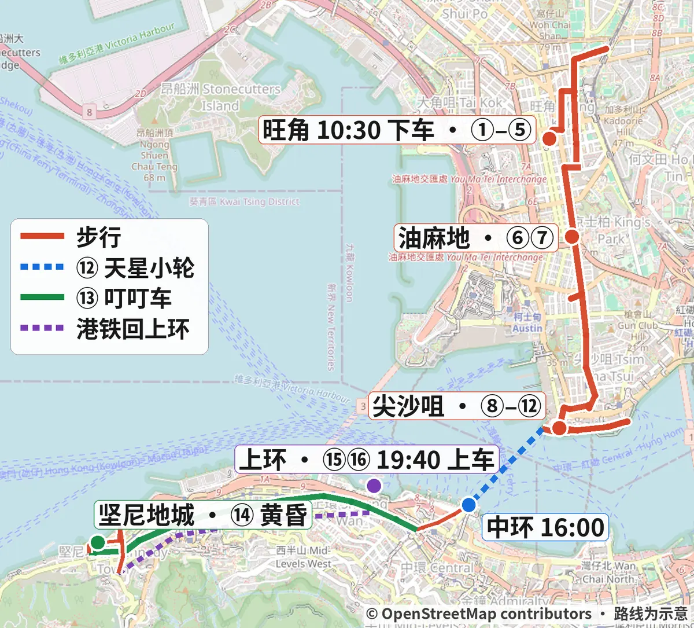

# 深圳 → 香港 周六一日游

2026 年 11 月 14 日（周六）。深圳大悦城坐环岛中港通大巴出发，旺角逛吃、尖沙咀看海、坚尼地城看黄昏，上环坐大巴回宝安大仟里。

**网页版（手机上看更方便）：<https://haoxiangntu.github.io/sz-hk-daytrip/>**

| 页面 | 内容 |
|---|---|
| [总览](https://haoxiangntu.github.io/sz-hk-daytrip/) | 时间表、路线图、周六天气、晚到或下雨时怎么调整 |
| [行程](https://haoxiangntu.github.io/sz-hk-daytrip/route.html) | 16 站逐个展开：怎么走、看什么、吃什么；每一站下面折叠着“历史与文化” |
| [大巴](https://haoxiangntu.github.io/sz-hk-daytrip/bus.html) | 买票、上车点、深圳湾过关步骤、完整班次、赶不上末班车怎么办 |
| [贴士](https://haoxiangntu.github.io/sz-hk-daytrip/tips.html) | 出发前清单、八达通、茶餐厅点餐用语、粤语、规矩、费用 |
| [来源](https://haoxiangntu.github.io/sz-hk-daytrip/about.html) | 资料来源、图片署名、还没确认的事项 |

## 一眼看完

| | |
|---|---|
| 去程 | **08:30** 深圳大悦城 10 号门 → 旺角朗豪坊（约 10:30 到） |
| 上午 | 旺角：金华冰厅、花墟道、雀鸟花园、金鱼街、女人街 |
| 下午 | 油麻地天后庙 → 沿弥敦道走到尖沙咀：1881、钟楼、星光大道 |
| 傍晚 | **15:45** 天星小轮到中环 → 叮叮车到坚尼地城，海旁看黄昏（日落 17:40） |
| 晚上 | 港铁回上环吃晚饭，**19:20** 到信德中心 |
| 返程 | **19:40** 上环信德中心 → 宝安大仟里（约 21:30–22:00 到），这是末班 |

底图 © OpenStreetMap contributors，路线为示意。

## 说明

- 巴士班次来自环岛中港通官网 2026-11-11 版深圳线单张，出发前在小程序里再核对一次。
- 到站时间、步行时间是估计的；餐厅营业时间以当天为准。详见[来源页](https://haoxiangntu.github.io/sz-hk-daytrip/about.html)。
- 照片来自 Wikimedia Commons，署名和许可列在来源页。

## 修改

页面内容都在 `tools/build.py` 里。改完在仓库根目录运行 `python3 tools/build.py`，会重新生成 5 个 HTML。
