# 深圳 → 香港 周六一日游攻略

**大悦城坐跨境大巴出发 · 旺角逛吃 · 尖沙咀看海 · 天星小轮过海 · 坚尼地城看日落 · 上环坐车回宝安大仟里**

> 按 **2026 年 11 月 14 日（周六）** 编排，之后的周六也适用（日落：11/14 17:40，11/21 17:39，11/28 17:38）。
> 巴士班次来自环岛中港通官网 2026-11-11 版深圳线单张，日落时间来自香港天文台月历。
> 班次、票价、营业时间可能临时调整，**周五晚上在环岛中港通小程序里再核对一次**。
> 图中照片来自 Wikimedia Commons（作者和许可见每张图下方和文末），用来认路和预览，不一定是当天的样子。

---

## 目录

1. [一页看懂：周六时间表](#一一页看懂周六时间表)
2. [路线图](#二路线图)
3. [出发前准备](#三出发前准备)
4. [去程：深圳大悦城 → 旺角](#四去程深圳大悦城--旺角)
5. [香港行程逐段详解](#五香港行程逐段详解)
6. [返程：上环信德中心 → 宝安大仟里](#六返程上环信德中心--宝安大仟里)
7. [赶不上末班车怎么办](#七赶不上末班车怎么办)
8. [费用估算](#八费用估算)
9. [注意事项与核对清单](#九注意事项与核对清单)
10. [资料来源、图片署名、待确认](#十资料来源图片署名待确认)

---

## 一、一页看懂：周六时间表

| 时间 | 地点 | 做什么 | 交通 / 备注 |
|---|---|---|---|
| 07:50 | 地铁 5 号线灵芝站 | 出站走去大悦城 | 步行约 5–10 分钟 |
| 08:10 | **深圳大悦城 10 号门 7-11 门口** | 找到环岛中港通工作人员、核对车票 | 提前 20 分钟到 |
| **08:30** | 大悦城 | **大巴发车**（宝安海雅线） | 车程约 30–40 分钟 |
| 约 09:10 | 深圳湾口岸 | 内地出境 → 香港入境 → 橙色柜台安排上车 | 周末早上按 30–60 分钟估 |
| **约 10:30** | **旺角朗豪坊**（港铁旺角站 E1 出口） | 下车 | 到达时间是估计，下面整体平移即可 |
| 10:35–11:10 | 弼街 · 金华冰厅 | 早午餐：菠萝油 + 奶茶 | 步行 8 分钟 |
| 11:10–11:45 | **花墟道** | 逛花街 | 步行 8 分钟 |
| 11:45–12:15 | **园圃街雀鸟花园** | 中式园林、鸟笼、鸟市 | 花墟道东头，步行 4 分钟 |
| 12:15–12:40 | **通菜街北段 “金鱼街”** | 一袋袋金鱼挂满店门 | 步行 10 分钟 |
| 12:40–13:30 | **女人街 · 西洋菜南街** | 摊档、药妆、街头小吃当午饭 | 金鱼街往南就是 |
| 13:30–14:00 | **弥敦道** 南下 | 港片里的招牌街景 | 步行 |
| 14:00–14:15 | **油麻地天后庙** | 百年古庙 | 步行约 15 分钟到 |
| 14:20–14:50 | 佐敦 · **澳洲牛奶公司** | 下午茶：炒蛋多士 + 炖奶 | 步行 8 分钟，可能排队 |
| 14:50–15:10 | 弥敦道 → 尖沙咀 | 继续步行 | 约 1.2 km |
| 15:10–15:30 | **1881 Heritage** | 前水警总部，殖民地建筑 | |
| 15:30–15:45 | **尖沙咀钟楼** | 旧火车站钟楼 | 步行 3 分钟 |
| 15:45–16:30 | **星光大道 · 维港 · K11 MUSEA** | 看海、拍对岸天际线 | 步行 10 分钟 |
| 16:30–16:45 | 尖沙咀天星码头 | 排队上船 | 步行 10 分钟回码头 |
| **16:45–16:55** | **天星小轮** | 尖沙咀 → 中环，坐上层 | 八达通 |
| 16:55–17:15 | 中环站 → 坚尼地城站 | 港铁港岛线 4 站 | 赶日落用港铁，回程再坐叮叮车 |
| **17:20–17:55** | **卑路乍湾海滨长廊** | **17:40 日落** | 坚尼地城站步行约 5–8 分钟 |
| 18:00–18:30 | **叮叮车** 坚尼地城 → 上环 | 坐上层车头，路过海味街 | HK$3.3 |
| 18:30–19:15 | 上环 | 晚饭 | 上环站一带 |
| **19:20** | **上环信德中心 招商局大厦地下 G05** | 到上车点 | 港铁上环站 D 出口 |
| **19:40** | 上环信德中心 | **大巴发车**（宝安登喜路线） | 周六最后一班 |
| 约 20:20 | 深圳湾口岸 | 香港出境 → 内地入境 → 右边 4–7 号车位 | |
| **约 21:30–22:00** | **宝安大仟里 L1 层 3 号门前** | 到家 | 估计值 |

**全天步行约 9–11 km**，大部分在九龙（旺角到尖沙咀约 6–7 km，分成很多段，中间有吃有坐）。

---

## 二、路线图

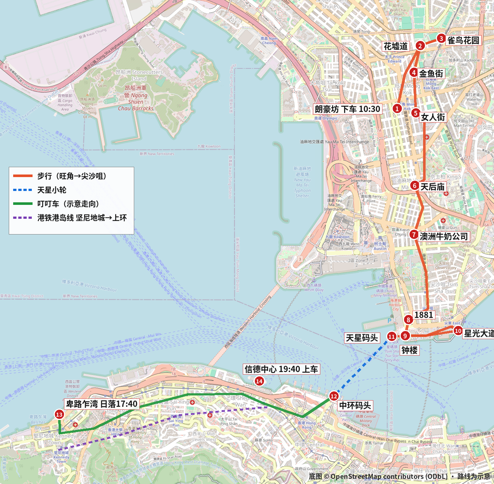

底图 © OpenStreetMap contributors（ODbL）。红色是步行，蓝色虚线天星小轮，紫色虚线港铁（去坚尼地城），绿色叮叮车（回上环，走向是示意）。编号对应下面第五节。

这条线的主体参考了百度地图路书 [RT31490305「香港秋日到此一游」](https://map.baidu.com/zt/pubTravel/book-share/index.html?no=RT31490305&business=2#/)（“旺角逛吃、尖沙咀看海”，全程 18.5 km）：起点旺角、花墟一带、尖沙咀海旁、过海到港岛西边、终点上环。分享页只公开了封面路线图，具体 7 个点要在百度地图 App 里看；这里是按封面图位置对出来的，并补了吃饭、交通和返程。

---

## 三、出发前准备

### 证件
- **港澳通行证 + 有效赴港签注**（个人旅游签注；深圳户籍可办“一签多行”）。用其他证件的按对应规定。
- 买票填的证件和过关用的证件必须是**同一本**（跨境巴士实名购票）。

### 支付
- **八达通**（必备）：港铁、叮叮车、天星小轮、便利店都刷它。iPhone 可下载“旅客版八达通”App 用微信支付开卡充值；安卓可用微信“八达通充值”小程序给实体卡充值；也可到港铁客务中心买实体卡。**建议充 HK$150**。
- **支付宝 / 微信支付**：大多数商店、餐厅能扫码。
- **现金 HK$200–300**：老茶餐厅、街边小吃、摊档有的只收现金。

### 随身物品
- 转换插头（香港是英式三方脚 G 型）、充电宝、流量（国际漫游或香港 / 大湾区 eSIM）
- 好走的鞋、一件薄外套（11 月中香港白天二十多度，傍晚海边有风）、折叠伞
- 小背包（过关要自己拿上所有东西下车）

### 手机准备
- 环岛中港通小程序（车票、班次）
- 高德或百度地图（香港能导航）、“港铁 MTR Mobile”App
- “我的天文台”App，周五晚上看周六天气

---

## 四、去程：深圳大悦城 → 旺角

### 4.1 买票
- 渠道：微信小程序 **“环岛中港通”**（或支付宝小程序），官网 <https://www.tilchinalink.com>。
- **去程**：上车点 **深圳大悦城**，**08:30** 班，下车点 **旺角朗豪坊**。
- **返程**：上车点 **上环信德中心**，**19:40** 班，下车点 **宝安大仟里**（宝安登喜路线）。
- 票价（官方单张，香港版）：

| 目的地 | 成人单程 | 成人双程 | 3–11 岁单程 | 3 岁以下单程 | 65 岁以上单程 |
|---|---|---|---|---|---|
| 九龙 / 港岛 / 东涌 | $65 | $105 | $45 | $10 | $65 |
| 新界 | $55 | $85 | $35 | $10 | $55 |

单张标价是港币，小程序里可能显示人民币价格，以下单页为准。去程和返程在同一张价目表里，可以试试能否按“双程”一起买；不行就各买单程。

### 4.2 到上车点
- **地址**：宝安区创业二路大悦城 **10 号门 7-11 便利店门口**。
- **地铁**：5 号线 **灵芝站**，出站后导航到“深圳大悦城 10 号门”，步行约 5–10 分钟（网上有说 C 口、有说 D 口，以地图为准）。
- **08:10 前到**。这班错过了，下一班要等到 14:30。

周六宝安海雅线各上车点发车时间（同一班车依次接客）：

| 上车点 | 早班 | 午班 | 傍晚（周六日） | 晚班 |
|---|---|---|---|---|
| 深圳创维创新谷亚朵酒店 | 07:45 | 13:45 | — | 18:45 |
| 海雅缤纷城 | 08:10 | 14:10 | 17:10 | 19:10 |
| 宝安福朋喜来登酒店 | 08:13 | 14:13 | 17:15 | — |
| **深圳大悦城** | **08:30** | 14:30 | 17:30 | 19:30 |

### 4.3 深圳湾口岸过关

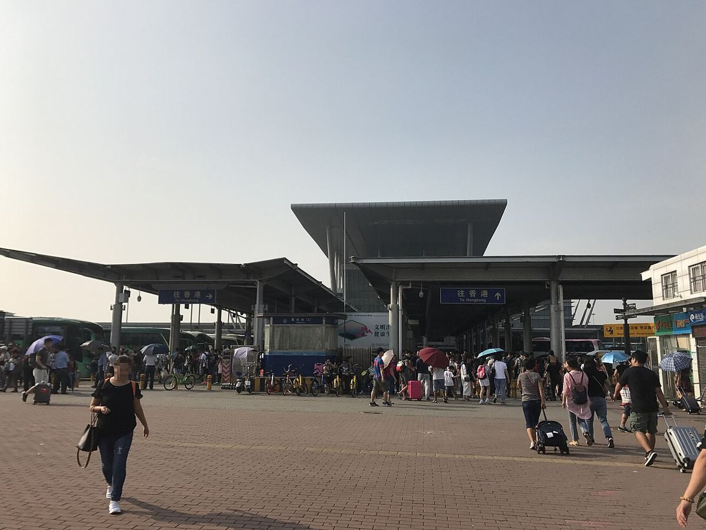

深圳湾口岸旅检大楼（深圳侧）。图：そらみみ · CC BY-SA 4.0 · [Wikimedia Commons](https://commons.wikimedia.org/wiki/File:Shenzhen_Bay_Checkpoint_Building_from_Shenzhen_side.jpg)

深圳湾是“一地两检”，内地出境和香港入境在同一栋楼里：
1. 大巴停在口岸，**拿上所有东西下车**。
2. **内地边检出境**：通行证可以走自助通道。
3. 沿通道往前走，**香港入境处入境**。
4. **过关后直走，找橙色的环岛中港通柜台**（单张原话：“往香港过关后请直走到橙色环岛中港通柜台安排乘车”），出示车票，工作人员安排上车。可能是原车，也可能换车。
5. 上车时说清楚**在旺角朗豪坊下车**。

### 4.4 到旺角
- 深圳湾到旺角车程约 40 分钟，**预计 10:15–11:00 到**。
- 下车点：**旺角朗豪坊门前（近港铁旺角站 E1 出口）**。朗豪坊商场里有洗手间，可以先整理一下。

---

## 五、香港行程逐段详解

> 编号对应路线图。时间按 10:30 到旺角写，晚到就整体往后推，**只要保证 16:45 左右上天星小轮**；时间不够时优先砍掉第 ⑥ 天后庙和第 ⑦ 下午茶。

### ① 10:35–11:10 早午餐：金华冰厅（旺角弼街）

- **怎么走**：朗豪坊出来沿上海街 / 西洋菜南街往北，到弼街右转，步行约 8 分钟。
- **点什么**：菠萝油（菠萝包夹厚牛油）、蛋挞、冻柠茶或热奶茶，人均约 HK$40–60。
- **小贴士**：周末常排队；不想排就在附近任何一家茶餐厅点“常餐”（通常是火腿通粉 + 煎蛋 + 多士 + 饮品），一样很地道。

### ② 11:10–11:45 花墟道

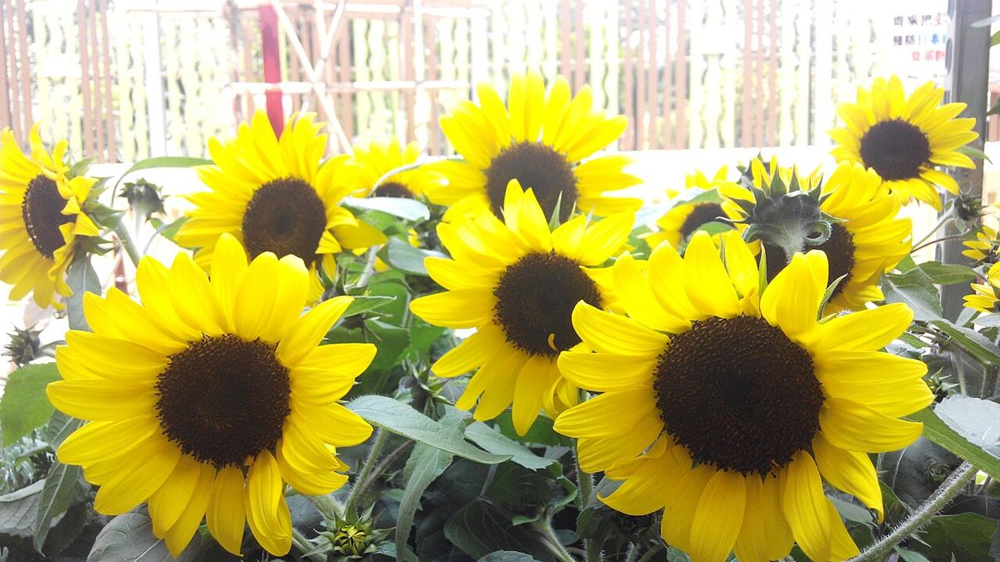

花墟道花店门口。图：MyPlace2015 mm · CC BY-SA 4.0 · [Wikimedia Commons](https://commons.wikimedia.org/wiki/File:HK_MongKok_Flower_Market_Road_Yellow_Daisy_Sunflowers_April_2015_RedMi.jpg)

- **怎么走**：弼街往北穿过太子道西，就到花墟道，步行约 8 分钟。
- **看什么**：一整条街的花店和园艺店，鲜花、多肉、盆栽摆满人行道，周末最热闹。
- **小贴士**：只能看不能带——**鲜花、植物、泥土不能带回内地**。

### ③ 11:45–12:15 园圃街雀鸟花园

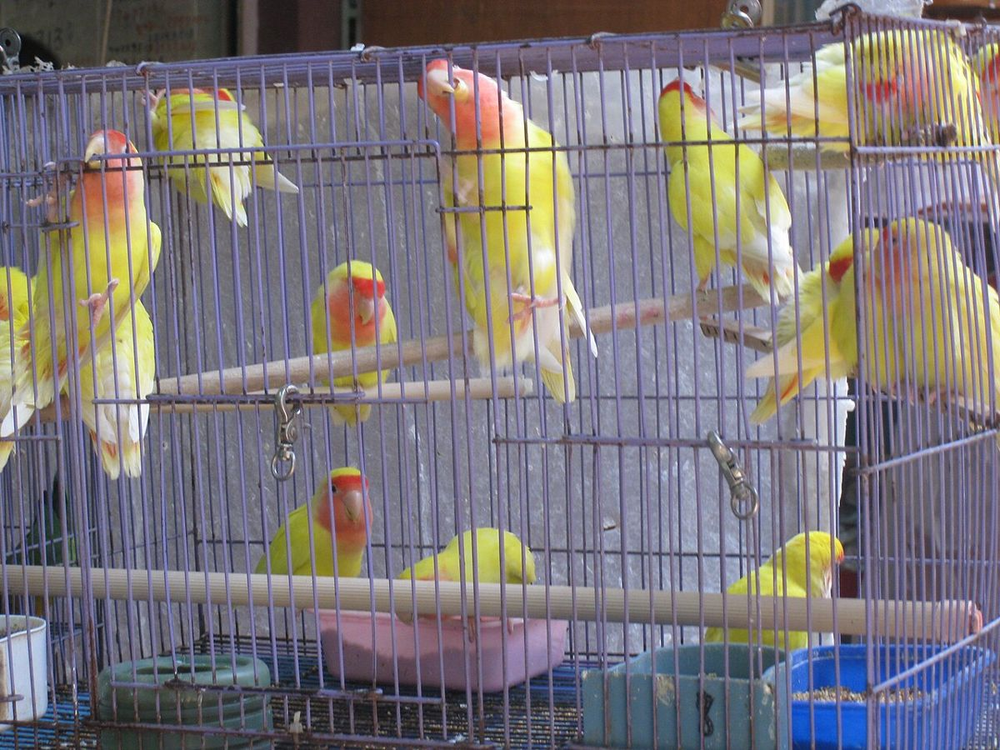

雀鸟花园的鸟笼。图：deror_avi · CC BY-SA 3.0 · [Wikimedia Commons](https://commons.wikimedia.org/wiki/File:Hong_Kong_Yuen_Po_Street_IMG_5532.JPG)

- **怎么走**：花墟道东头尽头，步行约 4 分钟。
- **开放**：通常 07:00–20:00，免费。
- **看什么**：中式园林里挂满鸟笼，老街坊带鸟来“遛鸟”、聊天，旁边是卖鸟、鸟笼和鸟食的档口。很有老香港味道，安静好拍。

### ④ 12:15–12:40 金鱼街（通菜街北段）

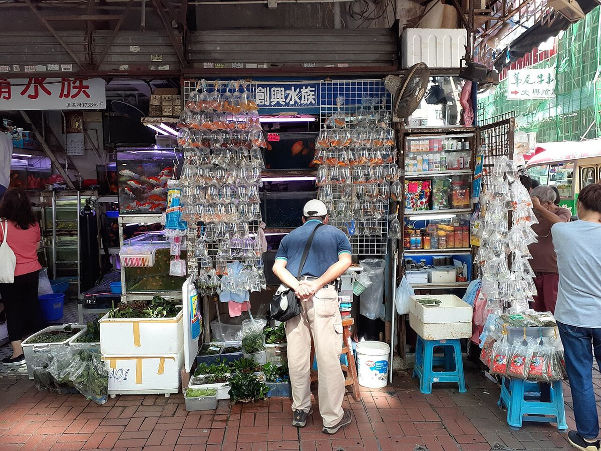

金鱼街水族店。图：Moaurpoe Tusiwm · CC BY-SA 4.0 · [Wikimedia Commons](https://commons.wikimedia.org/wiki/File:HK_MK_%E6%97%BA%E8%A7%92_Mongkok_%E5%BC%BC%E8%A1%97_Bute_Street_aquarium_shop_%E9%80%9A%E8%8F%9C%E8%A1%97_Tung_Choi_Street_plastic_bags_goldenfish_market_September_2021_SS2_25.jpg)

- **怎么走**：从雀鸟花园往西南走回弼街、通菜街，约 10 分钟。
- **看什么**：通菜街北段（弼街到旺角道一带）几十家水族店，门口挂着一袋袋金鱼和热带鱼，是旺角最上镜的街景之一。

### ⑤ 12:40–13:30 女人街 · 西洋菜南街（午饭 = 街头小吃）

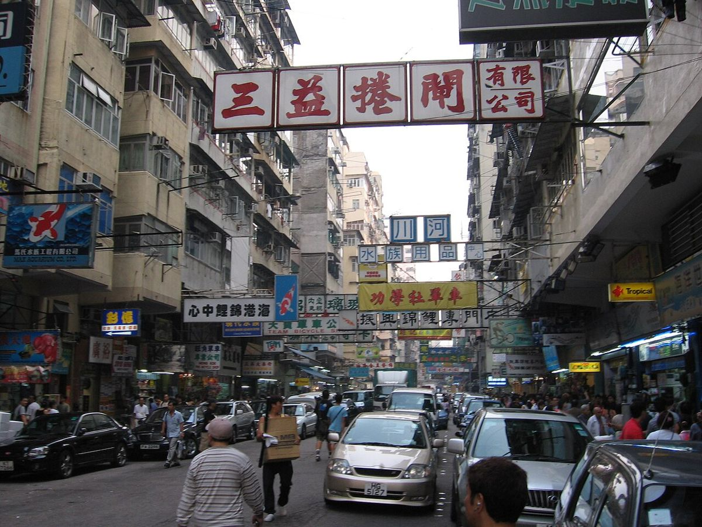

通菜街“女人街”（2005 年旧照）。图：PookieFugglestein · CC0 · [Wikimedia Commons](https://commons.wikimedia.org/wiki/File:Busy_scene_in_Tung_Choi_Street_on_2005.jpg)

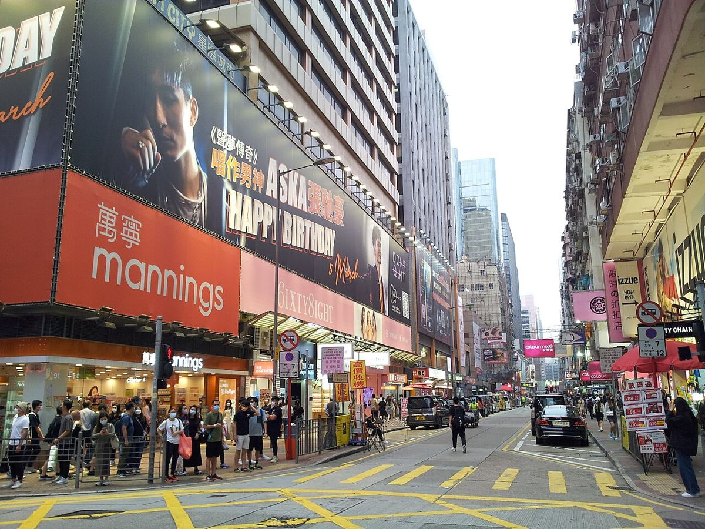

西洋菜南街。图：HilldeFirst · CC BY-SA 4.0 · [Wikimedia Commons](https://commons.wikimedia.org/wiki/File:Sai_Yeung_Choi_Street_South_2022.jpg)

- **女人街**：通菜街南段（旺角道往南到登打士街），摊档中午后陆续开，卖衣服、饰品、手机壳、纪念品，可以砍价。
- **西洋菜南街**：和通菜街平行，药妆店、电器店、楼上书店集中，周六人很多。
- **边走边吃当午饭**：咖喱鱼蛋、烧卖、鸡蛋仔、格仔饼、碗仔翅、肠粉、杨枝甘露，每样 HK$15–35。
- **小贴士**：人多，背包背在前面；买东西前先问价。

### 13:30–14:00 沿弥敦道南下

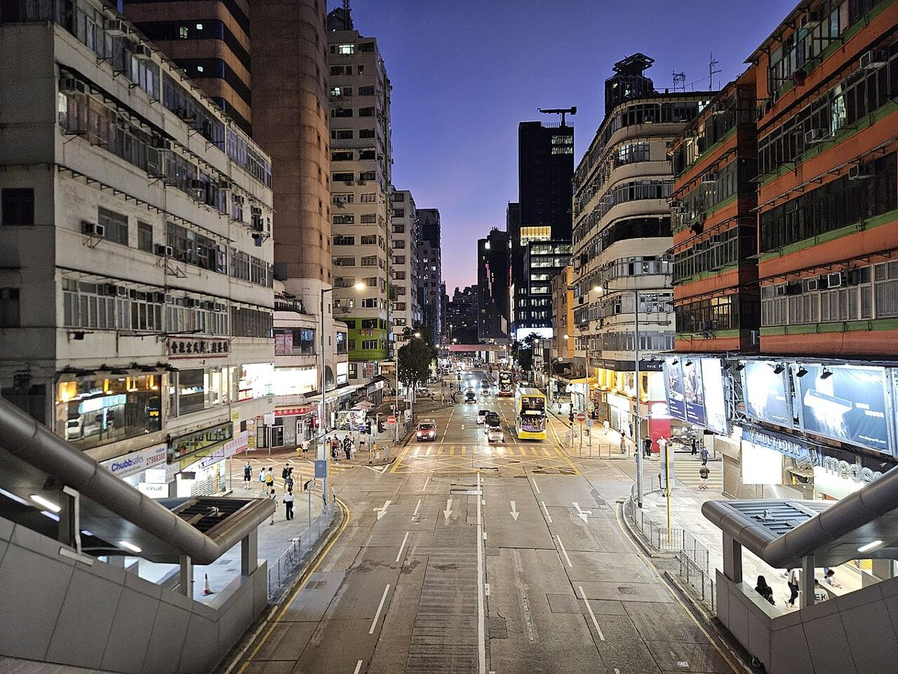

旺角道近弥敦道（夜景，白天招牌没亮，但楼群一样密）。图：姒姓賢寧 · CC BY-SA 4.0 · [Wikimedia Commons](https://commons.wikimedia.org/wiki/File:Mong_Kok_Road_near_Nathan_Road_at_night_in_August_2025.jpg)

- 沿**弥敦道**一路往南走，就是港片里霓虹招牌林立的那条大街。经过油麻地，楼会越来越老。
- **想省体力**：港铁荃湾线旺角站坐 2 站到尖沙咀站，直接跳到第 ⑧ 步。

### ⑥ 14:00–14:15 油麻地天后庙

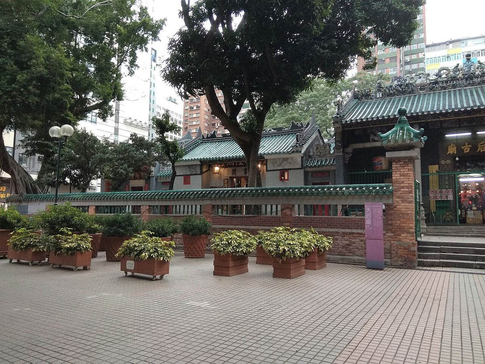

油麻地天后庙。图：Underwaterbuffalo · CC BY-SA 4.0 · [Wikimedia Commons](https://commons.wikimedia.org/wiki/File:Tin_Hau_Temple_Complex,_Yau_Ma_Tei_03.jpg)

- **怎么走**：弥敦道往西拐到庙街北端，步行约 15 分钟（从女人街算）。
- **看什么**：清代古庙群，庙前是榕树头广场。庙里香火缭绕，按规矩不要对着神像拍闪光照。
- **开放**：通常 08:00–17:00。庙街夜市要傍晚才开，白天只是普通街道。

### ⑦ 14:20–14:50 下午茶：澳洲牛奶公司（佐敦）

- **地址**：佐敦白加士街 47–49 号，步行约 8 分钟。
- **点什么**：炒蛋多士、火腿通粉、炖奶（双皮奶），人均约 HK$40–60。
- **小贴士**：老字号，节奏非常快，店员催单是“特色”；常排长队（周六尤其）。据说只收现金、逢周四休息，以店家为准。排队超过 20 分钟就放弃，留时间给尖沙咀。

### ⑧ 15:10–15:30 1881 Heritage（前水警总部）

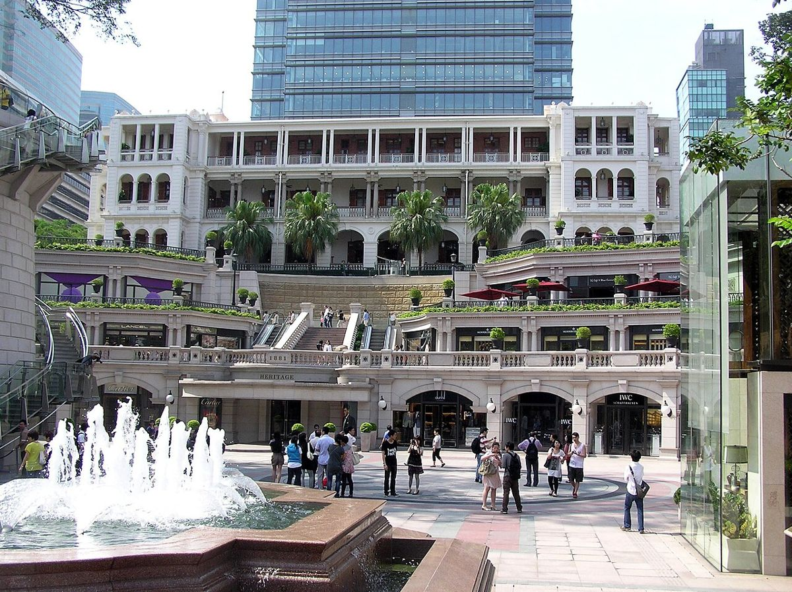

1881 Heritage。图：Alan · CC BY-SA 3.0 · [Wikimedia Commons](https://commons.wikimedia.org/wiki/File:1881_Heritage.JPG)

- **怎么走**：沿弥敦道走到尽头的梳士巴利道，约 1.2 km。
- **看什么**：19 世纪末的水警总部，白色拱廊和草坪，现在是商场和酒店，免费进去拍照。

### ⑨ 15:30–15:45 尖沙咀钟楼

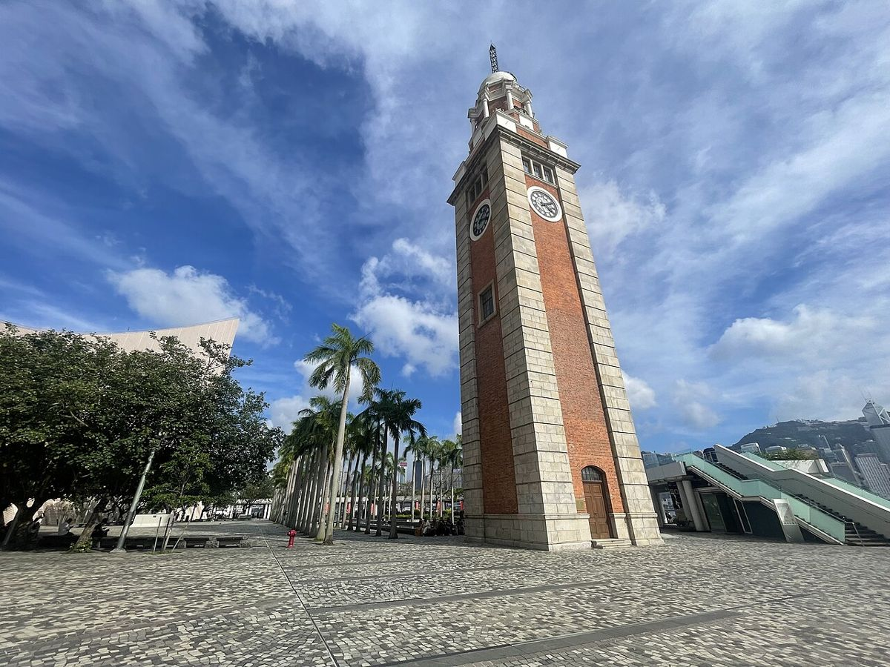

尖沙咀钟楼（前九广铁路钟楼）。图：Asatsuyu2022 · CC BY-SA 4.0 · [Wikimedia Commons](https://commons.wikimedia.org/wiki/File:Former_Kowloon-Canton_Railway_Clock_Tower_202406.jpg)

- **怎么走**：过马路往海边，步行约 3 分钟，就在天星码头旁边。
- **看什么**：1915 年九广铁路尖沙咀总站留下的钟楼，红砖配白石，背后就是维港。

### ⑩ 15:45–16:30 星光大道 · 维港 · K11 MUSEA

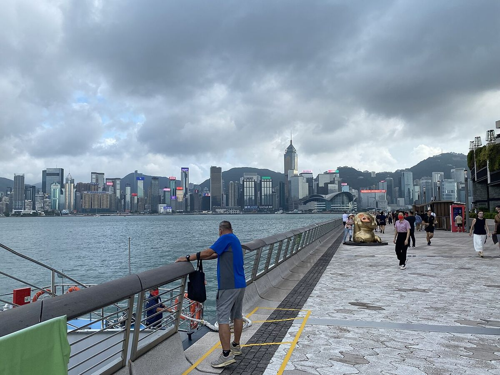

星光大道，对岸是港岛天际线。图：LN9267 · CC BY-SA 4.0 · [Wikimedia Commons](https://commons.wikimedia.org/wiki/File:Avenue_of_Stars_01-10-2022(1).jpg)

- **怎么走**：从钟楼沿海滨长廊往东走约 10 分钟。
- **看什么**：正对中环、湾仔的天际线，是“尖沙咀看海”最经典的位置；沿路有明星手印、李小龙像等。
- **K11 MUSEA**：就在星光大道旁的艺术商场，可以进去休息、上洗手间、买杯咖啡。
- **拍照**：下午 4 点阳光从西边照过来，对岸楼面偏逆光；想拍得好就站高一点，把海和天际线一起框进来。

### ⑪→⑫ 16:45–16:55 天星小轮：尖沙咀 → 中环

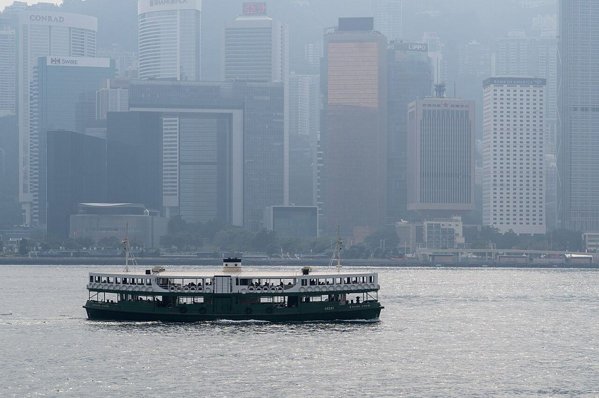

天星小轮横渡维港。图：Alexkom000 · CC BY 4.0 · [Wikimedia Commons](https://commons.wikimedia.org/wiki/File:2024-12-27_A_Star_Ferry_crosses_Victoria_Harbour_2.jpg)

- **16:30 往回走到天星码头**（钟楼旁），刷八达通入闸。周六上层票价约 HK$6.5（天星 2026 年 7 月申请加到 $8.5，是否已执行以码头公告为准）。
- 航程约 10 分钟，班次很密。**坐上层**，开船后往船尾看九龙，往船头看中环。
- 这一段就是百度路书里从尖沙咀斜穿海港那条线。

### 16:55–17:15 港铁去坚尼地城（赶日落）

- 中环码头（7 号码头）上岸后，跟着指示牌经国际金融中心（IFC）走到**港铁香港站 / 中环站**，约 8–10 分钟。
- 坐**港岛线往“坚尼地城”方向**：中环 → 上环 → 西营盘 → 香港大学 → 坚尼地城，约 10 分钟。
- 为什么这段不坐叮叮车：叮叮车从中环到坚尼地城要 30–40 分钟，容易错过 17:40 日落。叮叮车留到回程坐。

### ⑬ 17:20–17:55 卑路乍湾海滨长廊看日落

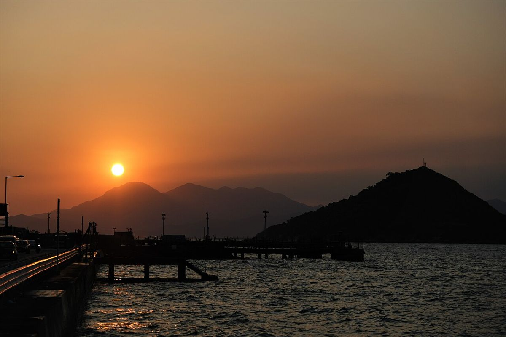

西环海边的日落（2019 年 10 月）。图：Smallpei · CC BY-SA 4.0 · [Wikimedia Commons](https://commons.wikimedia.org/wiki/File:Sunset_in_SaiWan_10,19.jpg)

- **怎么走**：坚尼地城站出来，跟着指示往北走到海边，约 5–8 分钟。
- **17:40 日落**，太阳落在西边海面和远处山影之间。日落后 15–20 分钟的蓝调时刻也很好看。
- 这里是本地人散步、钓鱼、看海的地方，比尖沙咀安静很多。

### 18:00–18:30 叮叮车：坚尼地城 → 上环

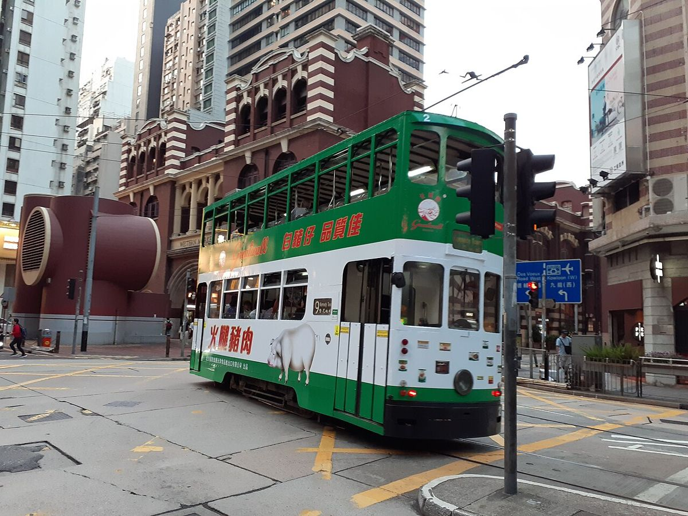

上环西港城旁的叮叮车。图：TiamHeiyPoastarod · CC BY-SA 4.0 · [Wikimedia Commons](https://commons.wikimedia.org/wiki/File:201911_Hong_Kong_Tramways_2_at_Western_Market_Terminus.jpg)

- 在坚尼地城（吉席街）电车总站上车，**往东的车都会经过上环**。上车不付钱，**下车时在前门拍八达通**，成人 HK$3.3。
- **坐上层车头**，慢慢穿过西环、西营盘的老街，窗外就是德辅道西的海味铺。
- 在 **西港城 / 上环街市** 一带下车，约 25–30 分钟。

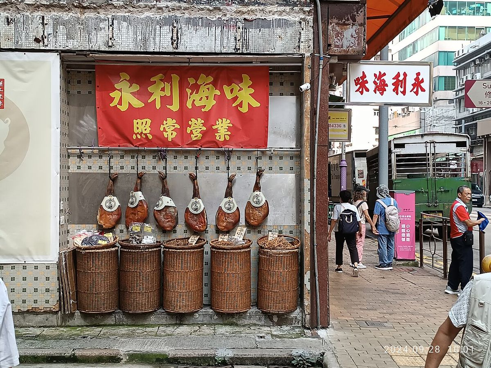

德辅道西的海味铺（叮叮车窗外就能看到）。图：JiayouMei XueAm · CC0 · [Wikimedia Commons](https://commons.wikimedia.org/wiki/File:HK_SYP_%E8%A5%BF%E7%87%9F%E7%9B%A4_Sai_Ying_Pun_%E5%BE%B7%E8%BC%94%E9%81%93%E8%A5%BF_Des_Voeux_Road_West_shop_%E6%B5%B7%E5%91%B3%E4%B9%BE%E8%B2%A8_dried_seafood_Wing_Lee_September_2024_R12S.jpg)

### 18:30–19:15 上环晚饭

- 上环站周边茶餐厅、粥面店、烧味饭店很多：烧鹅濑粉、云吞面、及第粥都是稳妥选择，人均 HK$60–120。
- 百度路书终点旁边就是一家**翠华餐厅**（连锁茶餐厅，菜单齐全、出餐快）。
- 时间紧：直接在**信德中心商场**里吃快餐，吃完下楼就是上车点。
- **19:15 结账出发**。

---

## 六、返程：上环信德中心 → 宝安大仟里

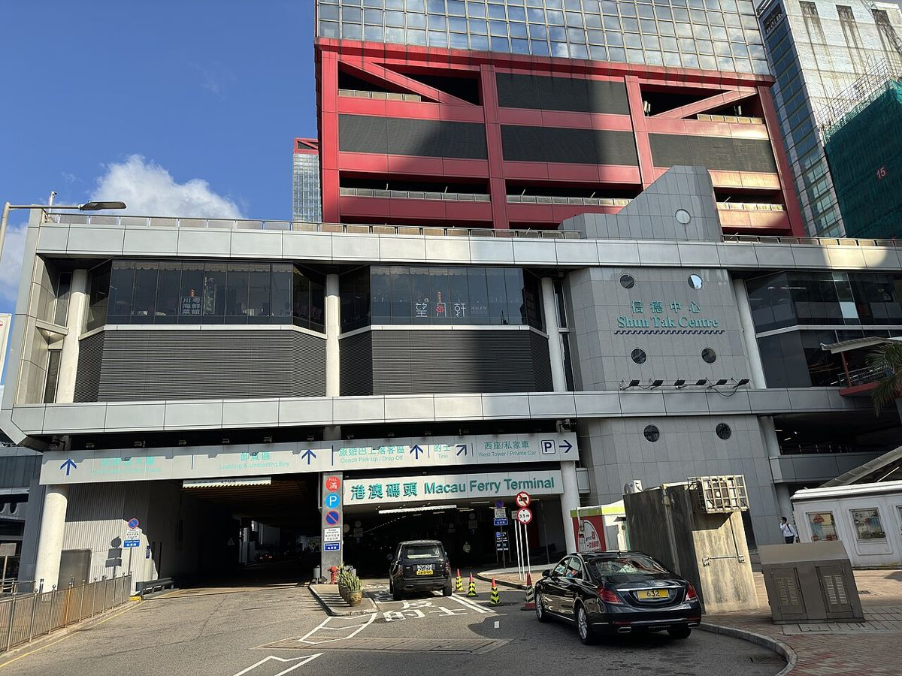

上环信德中心（也是港澳码头）。图：LN9267 · CC BY-SA 4.0 · [Wikimedia Commons](https://commons.wikimedia.org/wiki/File:Shun_Tak_Centre_21-02-2024.jpg)

### 6.1 上车点
- **上环信德中心 招商局大厦地下 G05 铺位**（近**港铁上环站 D 出口**）。
- 信德中心也是去澳门的港澳码头，人流很多。上车点是**环岛中港通的柜位**，不在码头里面。**19:20 前到**，先找到柜位再说。

### 6.2 周六宝安登喜路线（香港 → 宝安大仟里 / 登喜路国际大酒店）

| 上车点 | 第 2 班 | 第 3 班 | 第 4 班（末班） |
|---|---|---|---|
| **上环 信德中心** | 11:40 | 16:40 | **19:40** |
| 尖沙咀 K11 MUSEA | — | — | 19:20 |
| 尖沙咀 海港城 | 11:25 | 16:25 | 19:25 |
| 旺角 朗豪坊 | 11:30 | 16:30 | 19:40 |
| 太子 砵兰街 | 11:45 | 16:45 | 19:45 |
| 湾仔 | 11:25 | 16:25 | 19:25 |
| 铜锣湾 时代广场 | 11:10 | 16:10 | **周六没有** |

### 6.3 为什么选上环信德中心

| 从哪里过去 | 怎么去 | 大约用时 |
|---|---|---|
| 坚尼地城 | 叮叮车往东 | 25–30 分钟 |
| 坚尼地城 | 港铁港岛线 3 站 | 约 15 分钟（含进出站） |
| 中环天星码头 | 沿海旁往西走 | 15–20 分钟 |
| 尖沙咀 | 港铁到中环转港岛线 | 15–20 分钟 |
| 旺角 | 港铁到中环转港岛线 | 25–30 分钟 |

- **正好在行程终点**：日落后坐叮叮车往东就到，不走回头路。
- **港岛上发车最晚**：上环 19:40 比湾仔 19:25 晚，周六铜锣湾又没有晚班。
- **就在港铁站口**：万一迟到，马上能转港铁走“第七节”的兜底方案。

### 6.4 回程过关
1. 大巴到深圳湾口岸，**拿上所有东西下车**。
2. **香港出境**（香港入境处）→ 沿通道走 → **内地入境**（内地边检）。
3. 按单张：**过关后往右边 4–7 号车位**，找环岛中港通的车，继续坐到大仟里。
4. 大仟里下车点：宝安区海城路与新湖路交汇处 **宝安大仟里 L1 层 3 号门前**。预计 21:30–22:00 到。

---

## 七、赶不上末班车怎么办

19:40 是周六回大仟里的最后一班。按晚到程度选：

| 情况 | 办法 |
|---|---|
| 19:40 前能到尖沙咀而不是上环 | 改去 **K11 MUSEA 19:20** 或 **海港城 19:25**（要在小程序里改签，或现场问工作人员） |
| 错过 19:4x，但 20:10 前能到上环 / 旺角 | 环岛中港通 **“万象前海线”** 周六末班：海港城 19:55、湾仔 19:55、**上环 20:10**、**旺角 20:10**、太子 20:15；落客点 **深圳前海 JEN 酒店 / 万象前海东广场 / 深圳前海山姆**，再打车回宝安约 10 km。需另外买票 |
| 更晚 | 自己过关：港铁东铁线到 **罗湖** 或 **落马洲**，过关后转深圳地铁回宝安；或从 **西九龙站** 坐高铁到 **福田站** 再转地铁。深圳湾口岸旅检通常开到 24:00 |

---

## 八、费用估算（每人）

| 项目 | 估计（港币） |
|---|---|
| 跨境大巴 | $130（单程 $65 × 2；能买双程则 $105） |
| 港铁（中环 → 坚尼地城等） | $10–30 |
| 天星小轮 + 叮叮车 | $10–12 |
| 早午餐 | $40–60 |
| 街头小吃（午饭） | $50–100 |
| 下午茶 | $40–60 |
| 晚饭 | $60–120 |
| **合计** | **约 $340–510**，购物另算 |

---

## 九、注意事项与核对清单

### 注意事项
- **最重要：别错过 19:40 末班**。手机定 18:50 和 19:10 两个闹钟。
- **认准车**：口岸和上车点同时停很多跨境巴士，认准“环岛中港通”和线路名。
- **证件随身**，过关后不要放进大件行李里。
- **鲜花、植物、泥土、新鲜肉类不能带回内地**；购物注意入境免税额度。
- **香港靠左行驶**，过马路先看右边。**扶手电梯靠右站**。
- **港铁车厢内禁止饮食**。
- 紧急电话：香港 **999**；环岛中港通客服 香港 (852) 2979 8778、内地 (86) 4008 822 322。

### 周五晚上核对清单
- [ ] 通行证、签注有效；买票用的就是这本证件
- [ ] 去程票：**深圳大悦城 08:30 → 旺角朗豪坊**
- [ ] 返程票：**上环信德中心 19:40 → 宝安大仟里**
- [ ] 八达通开好并充值（约 HK$150）
- [ ] 漫游 / eSIM、充电宝、转换插头、薄外套、雨伞
- [ ] 港币现金 HK$200–300
- [ ] 看天文台周六预报；看环岛中港通公告有没有临时改班
- [ ] 灵芝站 → 大悦城 10 号门的路线先在地图上看一遍

---

## 十、资料来源、图片署名、待确认

### 资料来源
- 环岛中港通：上落站点指引 <https://www.tilchinalink.com/stations.php>；深圳线时间表（2026 年 11 月，单张编号 HKL-SZ-20261111）<https://www.tilchinalink.com/schedule_detail.php?id=7>
- 百度地图路书 RT31490305「香港秋日到此一游」：<https://map.baidu.com/zt/pubTravel/book-share/index.html?no=RT31490305&business=2#/>
- 香港天文台 2026 年 11 月月历（日出日落）：<https://www.hko.gov.hk/en/gts/astron2026/files/2026cal11.pdf>
- 天星小轮加价申请（2026 年 7 月）：[星岛](https://www.stheadline.com/zh-hans/politics/3594700/)、[香港01](https://global.hk01.com/社会新闻/60369567/)
- 电车票价 HK$3.3（2025 年 5 月 12 日起）：[立法会文件](https://www.legco.gov.hk/yr2025/chinese/hc/papers/hc20250425ls-43-c.pdf)
- 地点坐标：OpenStreetMap / Nominatim

### 图片署名
照片均来自 Wikimedia Commons，按原许可使用，只做了缩小尺寸。CC BY-SA 许可的图片，改编后须以相同许可分享。路线图底图 © OpenStreetMap contributors，按 ODbL 使用。

| 文件 | 原图 | 作者 | 许可 |
|---|---|---|---|
| `images/flower.jpg` | [HK MongKok Flower Market Road Yellow Daisy Sunflowers April 2015 RedMi.jpg](https://commons.wikimedia.org/wiki/File:HK_MongKok_Flower_Market_Road_Yellow_Daisy_Sunflowers_April_2015_RedMi.jpg) | MyPlace2015 mm | CC BY-SA 4.0 |
| `images/bird.jpg` | [Hong Kong Yuen Po Street IMG 5532.JPG](https://commons.wikimedia.org/wiki/File:Hong_Kong_Yuen_Po_Street_IMG_5532.JPG) | deror_avi | CC BY-SA 3.0 |
| `images/goldfish.jpg` | [HK MK 旺角 Mongkok 弼街 Bute Street aquarium shop 通菜街 Tung Choi Street plastic bags goldenfish market September 2021 SS2 25.jpg](https://commons.wikimedia.org/wiki/File:HK_MK_%E6%97%BA%E8%A7%92_Mongkok_%E5%BC%BC%E8%A1%97_Bute_Street_aquarium_shop_%E9%80%9A%E8%8F%9C%E8%A1%97_Tung_Choi_Street_plastic_bags_goldenfish_market_September_2021_SS2_25.jpg) | Moaurpoe Tusiwm | CC BY-SA 4.0 |
| `images/ladies.jpg` | [Busy scene in Tung Choi Street on 2005.jpg](https://commons.wikimedia.org/wiki/File:Busy_scene_in_Tung_Choi_Street_on_2005.jpg) | PookieFugglestein | CC0 |
| `images/sai.jpg` | [Sai Yeung Choi Street South 2022.jpg](https://commons.wikimedia.org/wiki/File:Sai_Yeung_Choi_Street_South_2022.jpg) | HilldeFirst | CC BY-SA 4.0 |
| `images/nathan.jpg` | [Mong Kok Road near Nathan Road at night in August 2025.jpg](https://commons.wikimedia.org/wiki/File:Mong_Kok_Road_near_Nathan_Road_at_night_in_August_2025.jpg) | 姒姓賢寧 | CC BY-SA 4.0 |
| `images/tinhau.jpg` | [Tin Hau Temple Complex, Yau Ma Tei 03.jpg](https://commons.wikimedia.org/wiki/File:Tin_Hau_Temple_Complex,_Yau_Ma_Tei_03.jpg) | Underwaterbuffalo | CC BY-SA 4.0 |
| `images/h1881.jpg` | [1881 Heritage.JPG](https://commons.wikimedia.org/wiki/File:1881_Heritage.JPG) | Alan | CC BY-SA 3.0 |
| `images/clock.jpg` | [Former Kowloon-Canton Railway Clock Tower 202406.jpg](https://commons.wikimedia.org/wiki/File:Former_Kowloon-Canton_Railway_Clock_Tower_202406.jpg) | Asatsuyu2022 | CC BY-SA 4.0 |
| `images/avenue.jpg` | [Avenue of Stars 01-10-2022(1).jpg](https://commons.wikimedia.org/wiki/File:Avenue_of_Stars_01-10-2022(1).jpg) | LN9267 | CC BY-SA 4.0 |
| `images/ferry.jpg` | [2024-12-27 A Star Ferry crosses Victoria Harbour 2.jpg](https://commons.wikimedia.org/wiki/File:2024-12-27_A_Star_Ferry_crosses_Victoria_Harbour_2.jpg) | Alexkom000 | CC BY 4.0 |
| `images/tram.jpg` | [201911 Hong Kong Tramways 2 at Western Market Terminus.jpg](https://commons.wikimedia.org/wiki/File:201911_Hong_Kong_Tramways_2_at_Western_Market_Terminus.jpg) | TiamHeiyPoastarod | CC BY-SA 4.0 |
| `images/belcher.jpg` | [Sunset in SaiWan 10,19.jpg](https://commons.wikimedia.org/wiki/File:Sunset_in_SaiWan_10,19.jpg) | Smallpei | CC BY-SA 4.0 |
| `images/shuntak.jpg` | [Shun Tak Centre 21-02-2024.jpg](https://commons.wikimedia.org/wiki/File:Shun_Tak_Centre_21-02-2024.jpg) | LN9267 | CC BY-SA 4.0 |
| `images/dried.jpg` | [HK SYP 西營盤 Sai Ying Pun 德輔道西 Des Voeux Road West shop 海味乾貨 dried seafood Wing Lee September 2024 R12S.jpg](https://commons.wikimedia.org/wiki/File:HK_SYP_%E8%A5%BF%E7%87%9F%E7%9B%A4_Sai_Ying_Pun_%E5%BE%B7%E8%BC%94%E9%81%93%E8%A5%BF_Des_Voeux_Road_West_shop_%E6%B5%B7%E5%91%B3%E4%B9%BE%E8%B2%A8_dried_seafood_Wing_Lee_September_2024_R12S.jpg) | JiayouMei XueAm | CC0 |
| `images/sbport.jpg` | [Shenzhen Bay Checkpoint Building from Shenzhen side.jpg](https://commons.wikimedia.org/wiki/File:Shenzhen_Bay_Checkpoint_Building_from_Shenzhen_side.jpg) | そらみみ | CC BY-SA 4.0 |

### 待确认 / 估计的部分
- 百度路书 7 个点的具体名称（分享页没公开，按封面图位置推断）。
- 大巴总耗时、到旺角和到大仟里的时刻（按距离和周末过关排队估计）。
- 去程在深圳湾是原车继续还是换车（单张写“到柜台安排乘车”）。
- 天星小轮周末票价是否已调整。
- 餐厅、庙宇、市集的营业时间以当天为准。
